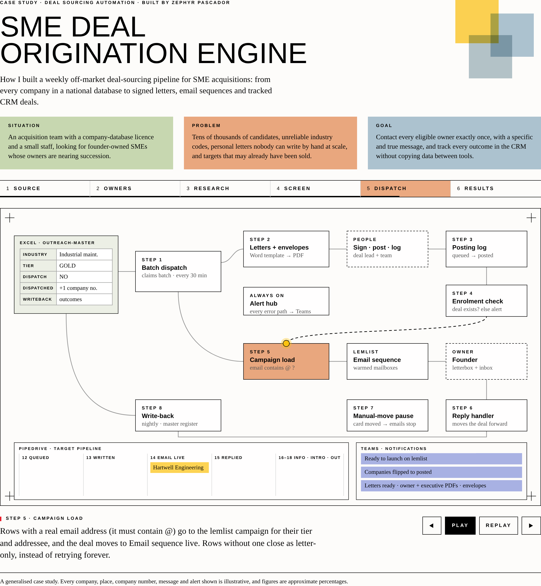

# SME Deal Origination Engine

An animated case study of an off-market deal-sourcing pipeline for SME acquisitions: from every company in a national database to signed letters, email sequences and tracked CRM deals.

**[Watch the animated walkthrough →](https://zpascador.github.io/sme-deal-origination-engine/)**

## The six stages

1. **Source.** Start with 100% of registered companies and filter them by revenue, EBITDA, age, ownership structure and ownership location, down to a target universe of about 3.6%.
2. **Owners.** Follow each company's ownership chain through the company registers, holding company by holding company, until it reaches real people. Matching surnames between the board and the chain confirms family control and picks the owner to contact.
3. **Research.** An AI agent finds each company's website, confirms its identity by company number, and drafts a short personalised primer. A second model checks every claim against a quote from the site.
4. **Screen.** Combined web searches look for prior sales, private-equity entry and insolvency. Flagged companies go to human review with their sources attached.
5. **Dispatch.** Eight automated steps take a batch from one cell in Excel to CRM deals, merged letters and envelopes, email sequences, reply handling and a nightly write-back, with an alert hub watching every step.
6. **Results.** About 90% of targets researched, one approach per owner, and two human inputs per batch.

## Stack

Company database · Python · LLMs via OpenRouter · Make.com · Excel on SharePoint · Word → PDF · lemlist · Hunter.io · Pipedrive · Microsoft Teams

## Running it

The whole walkthrough is a single `index.html` with no build step: open it in a browser, or serve the repo with GitHub Pages.

---

This is a generalised case study. Every company, person, place, company number, message and alert is illustrative, and figures are approximate percentages.
